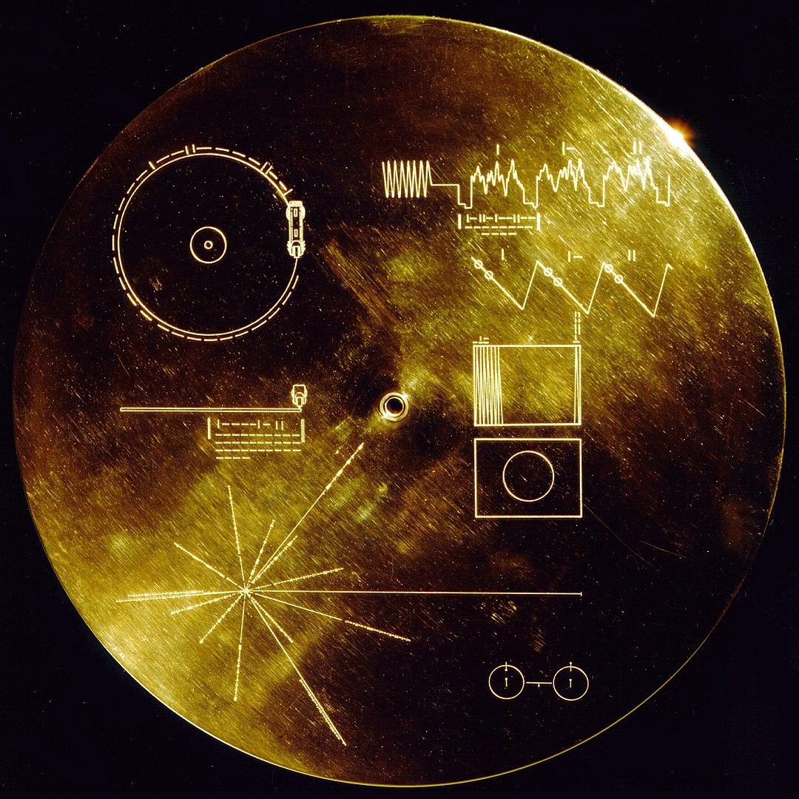
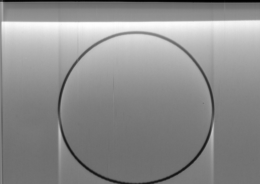
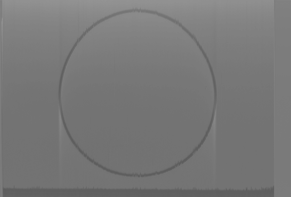
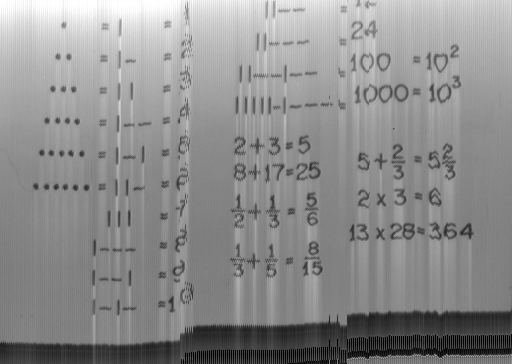
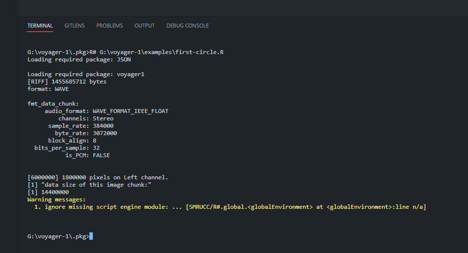

# voyager-1

Voyager 1 is a space probe that was launched by NASA on September 5, 1977. Part of the Voyager program to study the outer Solar System, Voyager 1 was launched 16 days after its twin, Voyager 2. --[Wikipedia](https://en.wikipedia.org/wiki/Voyager_1)



this repository contains the necessary code for R# scripting to decode the image data on the Voyager Golden Record.

> **Credits**: the test wav file data and part of the decoder algorithm implementation is comes from the project repository: [Voyager-Golden-Record-Decoder](https://github.com/mmcc1/Voyager-Golden-Record-Decoder).

# how the image data is decoded

the golden record is an **analog** disk: the image data is stored as an amplitude
modulated audio signal, one audio channel carries a sequence of images and every
scan line of an image is one period of the line synchronization rhythm:

```
wave samples -> line sync grid -> per scan line demodulation -> intensity matrix -> auto levels rendering
```

the decoder **measures** the parameters from the waveform data itself instead of
using the hard coded window: the scan line period is found by the autocorrelation
of the signal envelope, every scan line start position is located by the adaptive
threshold peak detection with the parabolic sub sample interpolation, and the
pixel clock is calibrated by the very first calibration circle image of the disk
(the calibration circle must be a true circle, this is the only way for checking
the pixel aspect ratio).

## measured parameters of the golden record

| parameter | measured value | how it is measured |
| --------- | -------------- | ------------------ |
| sample rate | 384000 Hz, 32 bit stereo | the wave file header |
| scan line period | 3197.3 samples (120.10 Hz) | autocorrelation of the rectified signal envelope |
| line period drift | about 1.3 samples/line, the residual jitter std is 12~30 samples | the linear regression of the successive sync pulse intervals |
| pixel clock | 7.50 samples/pixel (51.2 kHz) | the calibration circle is a true circle only at this clock |
| pixel cell slots | 426.3 slots per scan line period | the scan line contains the leading blanking/sync region |
| image size | 512 scan lines x 364 pixel cells | the same size as the official calibration image (529 x 364) |
| brightness encoding | amplitude-continuous | the local amplitude integral, it is NOT the pulse position modulation: the envelope peaks per pixel is about 0 |
| color component | none (gray scale) | 93.5% of the spectrum energy is below 5 kHz and there is no chroma sub carrier |
| left / right channel | different image sections | the correlation is only 0.21, so the two channels are independent image sections |

because there is no color sub carrier on the disk, the decoder produces the gray
scale image by default, and a pseudo color rendering is available for fun (see
the ``palette``/``luminous`` parameters).

## the decoding quality

the original implementation cut a fixed 3400 sample window on every scan line and
treated the maximum value of the window start section as the scan line start
position. the alignment error accumulated along the scan lines, so the decoded
image was smeared and the circles became ellipses. the new implementation:

* locates the scan line start by the adaptive threshold peak detection on the
  envelope and the parabolic interpolation for the **sub sample** precision;
* regresses the per scan line period for removing the time base drift, then
  aligns every scan line to its neighbour by the cross correlation;
* removes the per scan line baseline (a linear trend), so the vertical stripes of
  the original decoder are eliminated;
* resamples the samples of a scan line into the pixel cells by the **area
  averaging** (with the exact sub sample cell boundaries), so the pixel phase is
  identical on every scan line;
* normalizes the intensity by the **percentile auto levels** instead of the
  global min/max, so a single spike outlier can not compress the image into a
  flat gray any more;
* renders the image directly into the locked bitmap buffer, the polarity is
  inverted by default because the disk stores the image as a photographic
  negative (the ink of the picture is a negative amplitude excursion).

the optional ``smooth`` parameter averages a few neighbouring scan lines for
suppressing the per scan line gain noise of the analog recording.

| calibration circle (new decoder) | calibration circle (original decoder) |
| -------------------------------- | ------------------------------------- |
|  |  |

the geometrical shapes are kept: the measured ring extents ratio of the
calibration circle is ``dy/dx = 0.98`` (the ink line of the ring is only about
3 pixels wide, so the measurement itself has a few percent of uncertainty), and
the text of the mathematical definitions image is readable:



## verification

the pixel clock calibration is checked by the roundness of the calibration circle
(the ``--ring`` mode), the measured parameters of the four image sections on the
disk are almost identical, this is a strong evidence that the measured scan line
period and pixel clock are the true ones:

| image section | start frame | line period | samples/pixel | jitter std |
| ------------- | ----------- | ----------- | ------------- | ---------- |
| Calibration circle | 6000208 | 3197.344 | 7.5002 | 12.1 |
| Solar location map | 8465560 | 3196.716 | 7.4987 | 24.5 |
| Mathematical definitions | 10686671 | 3197.594 | 7.5008 | 29.9 |
| Physical unit definitions | 13001000 | 3197.620 | 7.5009 | 23.6 |

the raster orientation and the ink polarity are checked against the official
reference images by the ``--compare`` mode (the residual correlation is polarity
sensitive, the low frequency correlation is only the background tonality):

```bash
$ test --compare --image docs/decoded/circle.png --reference docs/circle.png
candidate 512 x 364 vs reference 529 x 364: direct=-0.5666, transposed=-0.0138, ink=0.0114 => direct
the orientation : direct (the absolute value of the correlation is used)
the ink polarity: inconclusive (the residual correlation 0.0114 is too weak, ...)
```

the ``ink`` correlation of the legacy decoder output changes from ``-0.05`` to
``+0.01`` after the black/white polarity fix, the ink polarity is confirmed by
the readable text of the mathematical definitions image (the ink is dark and the
paper is light, just like the official images).

# demo and library usage

## decode with the command line tool

the ``src/test`` project also provides a command line tool for the decoding,
diagnosis and the batch export:

```bash
# print the empirical analysis of the image data section, and save it as json
dotnet src/test/bin/Debug/net10.0/test.dll --diagnose --json docs/decoded/diagnose.json

# decode one image data section, the output image is 512 x 364
dotnet src/test/bin/Debug/net10.0/test.dll --decode --out docs/decoded/circle.png

# decode with the pixel column profile data exported as csv
dotnet src/test/bin/Debug/net10.0/test.dll --decode --csv docs/decoded/circle.csv

# batch export all of the images of the whole disk
dotnet src/test/bin/Debug/net10.0/test.dll --batch --out docs/decoded

# measure the calibration circle roundness for the pixel clock calibration
dotnet src/test/bin/Debug/net10.0/test.dll --ring

# compare the decoded image with a reference image
dotnet src/test/bin/Debug/net10.0/test.dll --compare --image docs/decoded/circle.png --reference docs/images/Calibration_circle.png

# dump the raw waveform structure and the intermediate images
dotnet src/test/bin/Debug/net10.0/test.dll --probe --out docs/decoded/probe
```

the reference image of the ``--compare`` mode can be a png file or any other image
format which is supported by the System.Drawing library (the legacy image files of
this repository are bmp files with a ``.png`` file name).

run the tool without arguments for the full usage of the options.

## decode with the R# script

Here is an example ``R#`` script for decode the first circle image in the goden record:

```R
# R# "E:\voyager-1\Rscript\first-circle.R" --debug --ignore-missing-startup-packages

imports "voyager1" from "voyager-1";
imports "wav" from "signalKit";

const goldenRecord as string = "J:\GoogleDrive\Voyager\384kHzStereo.wav";

# A demo R# script for image decode from the goden record wave data
# this very first circle image on the goden record is used for 
# parameter calibration of the image decoder
using wav as read.wav(file = file(goldenRecord), lazy = TRUE) {
    # view of the raw file data summary;
    print(wav);

    # parameters of the first circle image
    # and wav decoder arguments
    let first_circle = new image.chunk(channel = "Left", start = 6000208, length = 1928181);
    let decoder = new decode(pixels = 364, lines = 512);

    print(first_circle);
    print("data size of this image chunk:");
    print(wav :> chunk_size(chunk = first_circle));

    # the empirical analysis of the data section
    print(wav |> decode.report(chunk = first_circle));

    # run decoder and save the
    # result image file
    wav 
    :> decode(chunk = first_circle, decode = decoder)
    :> as.bitmap(smooth = 2)
    :> bitmap(file = `${dirname(!script$dir)}/docs/decoded/circle.png`)
    ;
}
```

Run the demo script with R# interpreter:



## the script function parameters

``decode(wav, chunk, decode, size = 0, pixels = 0, lines = 0, align = TRUE, guard = 0)``

| parameter | default | description |
| --------- | ------- | ----------- |
| chunk | - | the image data section on the wave file |
| decode | - | the decoder arguments, the invalid values are filled by the measured ones |
| size / pixels | 364 | the pixel cells (the image rows) inside a single scan line |
| lines | 512 | the number of the scan lines (the image columns) |
| align | TRUE | apply the per scan line synchronization |
| guard | 0 | the samples which are skipped after the sync pulse position |
| offsetLeft / offsetRight | 0.2 | the legacy parameters of the original implementation, they are not used any more |

``as.bitmap(pixels, luminous = FALSE, white = 1, gamma = 1, invert = TRUE, percentile = NULL, palette = "gray", smooth = 0, height = 0)``

| parameter | default | description |
| --------- | ------- | ----------- |
| luminous | FALSE | render the image as the pseudo color image |
| white | 1 | the white point gain, 0 or 1 means no adjustment |
| gamma | 1 | the gamma correction, 1 means no correction |
| invert | TRUE | the black/white polarity |
| percentile | NULL | the black point and the white point percentiles, like ``c(0.005, 0.995)`` |
| palette | "gray" | the palette name of the pseudo color rendering |
| smooth | 0 | the radius of the across scan line smoothing, 0 for disable |
| height | 0 | the output image height in pixels, 0 for keep the original size |

``decode.report(wav, chunk, env_window = 96)``

prints the empirical analysis of the image data section: the scan line period, the
line period drift, the sync pulse interval distribution, the pixel clock, the
brightness encoding scheme and the color component detection result.

at last you could fine tuning the result image output in photoshop to make it more clarity.
